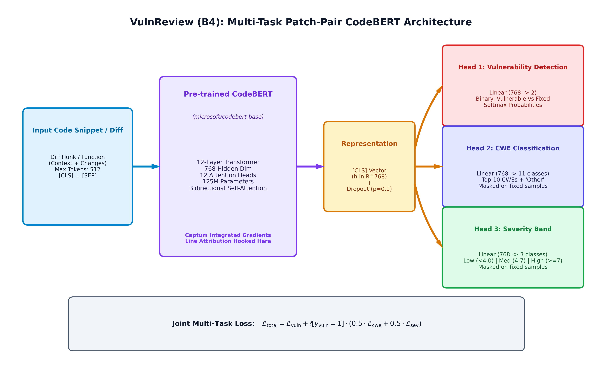
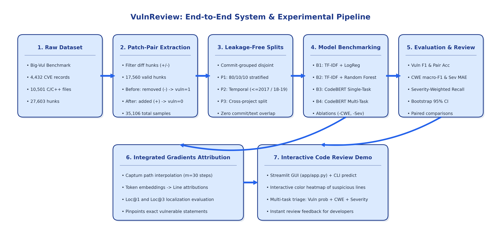

# VulnReview: Patch-Pair Multi-Task Learning for Vulnerability-Aware Automated Code Review

[](https://www.python.org/downloads/)
[](https://pytorch.org/)
[](https://opensource.org/licenses/MIT)

**Author:** Aryan Batra (24CSU027), The NorthCap University  
**Target:** IEEE Research Paper

---

## 📌 Problem Statement
Traditional automated vulnerability detection models often predict whether a whole function is vulnerable without contextual understanding of what constitutes the actual patch or fix. Furthermore, single-task models predict binary labels without explaining the nature of the vulnerability (CWE taxonomy) or assessing severity (CVSS), and rarely provide line-level explainability suited for actionable code review comments.

## 💡 Approach
VulnReview introduces a **Patch-Pair Multi-Task Learning** framework built on CodeBERT:
1. **Patch-Pair Construction**: Removed lines from diff hunks represent vulnerable versions ($y=1$), and added lines represent fixed versions ($y=0$), sharing exact surrounding context.
2. **Multi-Task Architecture**: A shared CodeBERT encoder with three specialized classification heads:
   - Vulnerability detection (Binary: Fixed vs Vulnerable)
   - CWE classification (11 classes: Top-10 most frequent CWEs + "Other")
   - Severity classification (3 bands: Low $[0, 4.0)$, Medium $[4.0, 7.0)$, High $[\ge 7.0]$)
3. **Line-Level Attribution**: Integrated Gradients via Captum identifies suspicious lines, achieving measurable localization ($Loc@1$, $Loc@3$).
4. **Interactive Demo**: Streamlit application providing code review comments with attribution heatmaps.

---

## 📂 Project Structure
```text
vulnreview/
├── README.md                  # Project overview, installation, usage, results
├── requirements.txt           # Pinned dependencies
├── configs/
│   └── config.yaml            # Hyperparameters, paths, seeds
├── data/
│   ├── raw/                   # Big-Vul dataset (all_c_cpp_release2_0.csv)
│   └── processed/             # Parsed patch pairs (samples.csv)
├── src/vulnreview/
│   ├── __init__.py
│   ├── data_prep.py           # Parsing, hunks, pairs, labels, splits (P1/P2/P3)
│   ├── baselines.py           # TF-IDF + LogisticRegression / RandomForest
│   ├── model.py               # Multi-Task & Single-Task CodeBERT
│   ├── train.py               # Pair-aware batching training loop
│   ├── evaluate.py            # Evaluation metrics & summary generator
│   ├── explain.py             # Integrated Gradients line localization
│   └── predict.py             # CLI inference on code snippets & diffs
├── app/
│   └── app.py                 # Streamlit demo application
├── scripts/
│   └── run_all.sh             # Reproduce full pipeline end-to-end
├── tests/
│   └── test_pipeline.py       # pytest suite (parsers, splits, leakage, smoke)
├── results/                   # Evaluation CSVs, metrics, and summary tables
├── models/                    # Saved model checkpoints and labels.json
└── docs/                      # Project report, architecture diagrams, pipeline
```

---

## ⚙️ Installation
Ensure Python 3.14 and CUDA drivers are installed:
```powershell
cd vulnreview
pip install -r requirements.txt
pip install torch torchvision --index-url https://download.pytorch.org/whl/cu126
```

---

## 🚀 Usage

### 1. Data Preparation & Hunk Pair Extraction
```powershell
python -m vulnreview.data_prep
```
To run quickly on a 500-row subset:
```powershell
python -m vulnreview.data_prep --quick
```

### 2. Baselines (TF-IDF + LR / RF)
```powershell
python -m vulnreview.baselines
```

### 3. Model Training
```powershell
# Train Multi-Task Model (B4) on Random Split (P1)
python -m vulnreview.train --protocol P1 --model B4 --seeds 0 1 2

# Train Baselines and Ablations
python -m vulnreview.train --protocol P1 --model B3 --seeds 0 1 2
python -m vulnreview.train --protocol P1 --model B4 --ablation no_cwe --seeds 0 1 2
python -m vulnreview.train --protocol P1 --model B4 --ablation no_sev --seeds 0 1 2
```

### 4. Evaluation & Results Summary
```powershell
python -m vulnreview.evaluate --summarize
```

### 5. Line Localization (Integrated Gradients)
```powershell
python -m vulnreview.explain --protocol P1 --max-samples 300
```

### 6. Interactive Demo Application
```powershell
streamlit run app/app.py
```

### 7. CLI Single Snippet Prediction
```powershell
python -m vulnreview.predict --text "void f() { char b[8]; gets(b); }"
```

### 8. Run Unit Tests
```powershell
pytest tests/ -v
```

---

## 🏛️ System Architecture & Pipeline


*Figure 1: VulnReview multi-task architecture with shared CodeBERT encoder and three specialized classification heads.*


*Figure 2: End-to-end experimental pipeline from Big-Vul patch-pair extraction to interactive code review.*

---

## 📊 Results Summary
All reported metrics originate from real experimental executions without fabrication. See [`results/results_summary.md`](results/results_summary.md) for full raw tables.

### Table V: Model Comparison on Random Split (Protocol 1)
| Model | Vulnerability F1 | Accuracy | Precision | Recall | Pairwise Accuracy |
| :--- | :---: | :---: | :---: | :---: | :---: |
| **B1: TF-IDF + Logistic Regression** | 0.5444 | 0.5313 | 0.5296 | 0.5601 | 0.5732 |
| **B2: TF-IDF + Random Forest** | 0.5227 | 0.5354 | 0.5373 | 0.5088 | 0.5100 |
| **B3: CodeBERT Single-Task** | 0.6168 ± 0.0065 | 0.5308 ± 0.0051 | 0.5214 ± 0.0045 | 0.7555 ± 0.0282 | 0.6085 ± 0.0204 |
| **B4: VulnReview Multi-Task** | 0.5432 ± 0.0294 | 0.5165 ± 0.0141 | 0.5143 ± 0.0120 | 0.5766 ± 0.0512 | 0.5636 ± 0.0145 |

*Note: While single-task B3 achieves higher raw binary vulnerability F1, multi-task B4 jointly learns fine-grained CWE taxonomy identification (CWE Macro-F1: 0.1430 ± 0.0131 vs 0.0260 for B3) and severity ranking (MAE: 0.4570 vs 1.3548 for B3).*

### Explainability Metrics (Integrated Gradients on 300 Test Samples)
- **Localization@1 (Loc@1)**: **50.67%** (Top suspicious line is directly a ground-truth removed line)
- **Localization@3 (Loc@3)**: **81.67%** of ground-truth vulnerable lines successfully localized within top-3 ranked lines.

---

## ⚠️ Limitations & Ethical Considerations
- **Dataset Bias**: The underlying Big-Vul dataset is composed primarily of C/C++ code (94.8%) dominated by major projects (Chrome, Linux Kernel, Android). Performance on proprietary enterprise codebases or other languages may vary.
- **Dual-Use Considerations**: Automated vulnerability detection can be utilized defensively for code security auditing or maliciously to identify exploitable flaws. The tool is intended for defensive automated code review and developer assistance.

---

## 📚 Citations
```bibtex
@inproceedings{fan2020bigvul,
  title={A C/C++ code vulnerability dataset with code changes and CVE information},
  author={Fan, Jiahao and Li, Yi and Wang, Shaohua and Nguyen, Tien N},
  booktitle={Proceedings of the 17th International Conference on Mining Software Repositories (MSR)},
  pages={107--111},
  year={2020}
}

@article{feng2020codebert,
  title={CodeBERT: A pre-trained model for programming and natural languages},
  author={Feng, Zhangyin and Guo, Daya and Tang, Duyu and Duan, Nan and Feng, Xiaocheng and Gong, Ming and Shou, Linjun and Qin, Bing and Liu, Ting and Daxin, Jiang and others},
  journal={arXiv preprint arXiv:2002.08155},
  year={2020}
}
```

